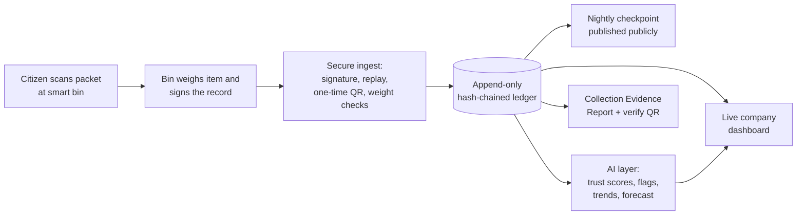

<div align="center">

# VeriBin

### We give EPR compliance a receipt.

**An AI-verified, QR-scan smart bin platform that turns every waste collection into tamper-evident evidence.**

Team **REMAINDERS** · PCCoE International Grand Challenge 2026 (Indradhanu) · Theme: **AI for Climate Change**


</div>

---

## Table of contents

1. [The problem](#the-problem)
2. [Our solution](#our-solution)
3. [How it works](#how-it-works)
4. [Architecture](#architecture)
5. [Software components](#software-components)
6. [Security and trust model](#security-and-trust-model)
7. [Repository structure](#repository-structure)
8. [Getting started](#getting-started)
9. [Build roadmap](#build-roadmap)
10. [Team](#team)

---

## The problem

Under India's **Extended Producer Responsibility (EPR)** rules, companies that sell plastic packaging must collect back a fixed share of it every year. Today, the only proof is a recycler's certificate. **Nothing records whether the plastic was ever physically collected.**

- CPCB audits uncovered **~6 lakh (600,000) fake EPR certificates**, and the NGT took suo motu notice in July 2024.
- About **₹355 crore** in penalties has been imposed on violators.
- The 2026 amendment introduces Registered Environment Auditors, but an auditor can only verify what is recorded, and **collection is not recorded today**.
- Packaging must carry a barcode or QR code, yet **nothing reads it at the point of collection**. Existing smart bins track fullness, not brand or plastic category.

## Our solution

VeriBin is the **evidence layer underneath EPR reporting**. Every time a citizen drops a packet into a VeriBin smart bin, the bin scans its code, weighs it and creates a **signed, time-stamped, location-tagged record** that is stored instantly in an append-only, hash-chained ledger. The same verified data powers:

- a **real-time company workspace** showing collection against targets in all 4 EPR plastic categories,
- an **AI layer** that detects suspicious activity, scores bin trustworthiness and forecasts target shortfalls by month 3–4 instead of year-end,
- **Collection Evidence Reports** in EPR format, each with a verification QR that anyone can use to check the numbers against the ledger.

> VeriBin reports are evidence-backed supporting records for official EPR filings. They do not replace CPCB-issued certificates.

## How it works



1. **Scan at the bin.** The user holds the packet's QR or barcode to the scanner. No app or phone is needed.
2. **Signed record.** The bin creates a record (bin ID, sequence number, time, product code, weight) and signs it with its own Ed25519 private key. If offline, records queue on the device.
3. **Secure ingest.** The cloud verifies the signature, rejects replays and reused one-time QR codes, checks the weight against the catalogue, and appends the record to that bin's hash chain, all in one atomic transaction.
4. **Real-time workspace.** The verified scan appears instantly in the owning company's dashboard.
5. **Nightly checkpoint.** A single fingerprint covering every bin's chain is created each night and published to a public repository, so history cannot be quietly rewritten.
6. **AI analysis.** A nightly job re-verifies integrity, scores each bin (0–100) with explainable reasons, flags suspicious scans, finds trends and forecasts shortfalls.
7. **Evidence reports.** Companies generate EPR-format reports; a QR on each report lets anyone re-check the figures against the ledger.

## Architecture

| Layer | Purpose | Technology |
| --- | --- | --- |
| Bin hardware | Scan, weigh, display, sign | ESP32, scanner, load cell, OLED, Wi-Fi / LoRa |
| Firmware | Read code, sign record, offline queue, sync | C++ / MicroPython |
| Bin simulator | Behaves exactly like a real bin for testing and demos | Node.js |
| Backend | Ingest, verify, store, serve, realtime | Supabase (Postgres, Edge Functions, Row-Level Security, Realtime, pg_cron, Storage) |
| Web app | Public website + company dashboard | Next.js, React, TypeScript, Tailwind CSS, shadcn/ui |
| AI layer | Read-only analysis and insights | Python, Pandas, Gemini API |
| Hosting and jobs | Deployment and scheduled work | Vercel, GitHub Actions |

### Design principles

- **Evidence is never changed.** The ledger is append-only at the database level. The AI layer has read-only access to it, and every insight links back to raw scans.
- **The model never does the arithmetic.** All numbers are computed in Python; Gemini only writes sentences around them, and its output is checked.
- **Hash chain, not blockchain.** Tamper-evident and cheap, anchored by a public daily checkpoint.
- **Works offline.** Bins queue scans and sync later.
- **Low cost.** Prototype bin target of ₹3,000–5,000.

## Software components

### 1. Backend (Supabase)

- **Database:** companies, products (catalogue), one-time QR codes, bins, scans (ledger), rejected scans, daily totals, targets, alerts, checkpoints, reports, and AI output tables. Models all 4 EPR plastic categories and the April–March financial year.
- **Secure ingest:** an Edge Function validates the record and verifies the Ed25519 signature, then a single database transaction runs the replay, timestamp, one-time-QR, barcode-cooldown and weight checks, appends to the bin's hash chain and updates totals.
- **Append-only ledger:** edits and deletes on scans are blocked for every role. Corrections are new entries.
- **Per-bin hash chains** plus a **daily checkpoint** (scheduled with pg_cron) that is published to a public GitHub repository.
- **Chain verification function** that reports the first broken record.
- **Roles and Row-Level Security:** company (own data), auditor (assigned companies), regulator (read-only, all), admin.
- **Private Realtime channels** per company for the live feed.
- **Alerts:** bin offline, sequence gap, anomaly, target at risk.

### 2. Web app and website (Next.js on Vercel)

- **Dashboard:** live scan feed, KPI cards, category progress against targets, monthly trends, filters, and drill-down from any total to individual signed scans.
- **Scan proof page** with in-browser signature verification.
- **Bins, Targets, Catalogue (with admin approval) and QR generation** screens.
- **AI Insights:** insight cards, anomaly list with trust scores, forecast with range, detector accuracy.
- **Reports:** generate, download (PDF + CSV) and verify Collection Evidence Reports.
- **Auditor view:** read-only, limited to assigned companies.
- **Public website:** Home, Live Data (anonymised national stats), AI Insights, Reports, How it works (with a live bin simulator), Checkpoints, About.

### 3. AI layer (Python, nightly on GitHub Actions)

- **Integrity check:** re-verifies every new signature and every bin's chain.
- **Bin trust score (0–100)** from explainable rules: rapid rescans, weight mismatch, very low weight, odd hours, barcode share, rejection rate, sequence gaps.
- **Scan-level flags** stored separately from the ledger.
- **Weekly trends and insight cards**, each linked to its underlying scans.
- **Shortfall forecast** per category for the financial year, with a likely range.
- **Gemini narration** that only rephrases precomputed numbers, with a template fallback.
- **Detector evaluation** against labelled fraud injected by the simulator.

## Security and trust model

| Threat | Defence |
| --- | --- |
| Forged scans | Per-bin Ed25519 keys; signature verified over the exact signed bytes; revocable bins |
| Replay of old records | Unique (bin, sequence) constraint and timestamp window |
| Reusing a QR code | 128-bit random serials, redeemed atomically exactly once |
| Barcode rescans | Separate lower-trust tier with cooldown, reported separately |
| Editing the ledger | Database-level append-only rules, per-bin hash chains, verification function |
| Rewriting the whole history | Nightly checkpoint published to a public repository |
| Data leaks between companies | Row-Level Security on every table, private realtime channels |
| AI altering evidence | AI role has no write access to the ledger |
| Exposed secrets | Service keys only on the server; private keys never committed |

## Repository structure

> Planned layout. Folders are added as each part is built.

```
.
├── database/        Supabase migrations, Edge Functions, seed data      (Backend)
├── web/             Next.js website and dashboard                        (Web app)
├── ai/              Python analysis, scoring, forecast, narration        (AI layer)
├── simulator/       Bin simulator and key generator                      (Backend)
├── docs/            Platform document, contracts, implementation guide
└── .github/
    └── workflows/   Nightly AI job, checkpoint publishing
```

## Getting started

> Setup instructions will be finalised as the components land. Prerequisites:

- Node.js 20+ and npm
- Python 3.12+
- Docker and the Supabase CLI
- A Supabase project (dev) and a Vercel account
- A Gemini API key (AI layer only)

General workflow:

1. Clone the repository.
2. Start Supabase locally and apply the migrations in `database/`.
3. Generate bin keys with the simulator's key generator and register the public keys.
4. Copy the example environment files in `web/` and `ai/`, then fill in your own values. **Never commit real keys.**
5. Run the web app locally and start the simulator to stream signed scans.

## Build roadmap

| Phase | Focus | Status |
| --- | --- | --- |
| 0 | Setup, shared contracts, mock dataset | 🔄 In progress |
| 1 | Database tables, app shell, analysis prototype | ⏳ Planned |
| 2 | Secure ingest, bin simulator, ingest tests | ⏳ Planned |
| 3 | Auth, Row-Level Security, realtime | ⏳ Planned |
| 4 | Dashboard on real data, catalogue and QR | ⏳ Planned |
| 5 | AI layer: integrity, trust score, flags, forecast, Gemini | ⏳ Planned |
| 6 | Checkpoints, verification, evidence reports | ⏳ Planned |
| 7 | Public website and live demo simulator | ⏳ Planned |
| 8 | Hardening, security checklist, end-to-end tests | ⏳ Planned |
| 9 | Demo preparation | ⏳ Planned |

**Later:** "Ask your data" questions, bin placement advisor, e-waste and battery catalogues, recycler weighbridge link for full chain of custody, regulator portal integration.

### Contribution workflow

- `main` is protected; all changes go through pull requests with one review.
- Branch names: `<area>-<feature>`, for example `backend-ingest` or `web-live-feed`.
- Database changes only through migration files, never by hand.

## Team

**Team REMAINDERS** · MIT Academy of Engineering, Alandi, Pune · B.Tech CSE (AI & ML) · SPPU

| Member | Role |
| --- | --- |
| Bode Khushi Yuvraj | Team Lead |
| Gatkal Durgesh Vijay | Member |
| Vaidya Yash Naresh | Member |
| Mahajan Sarthak Dileep | Member |

---

<div align="center">

*A small scan. A bigger change.*

</div>
